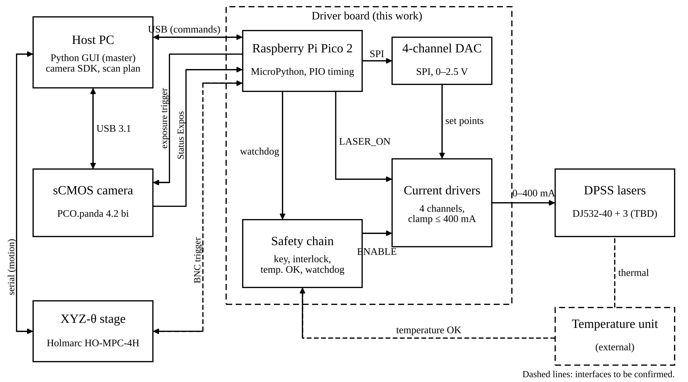

# Microscope Illumination Drivers — IIT Kharagpur Summer Internship 2026

Hi! This is where I keep everything I built during the **IEEE EMBS Summer Internship 2026** at IIT Kharagpur. The internship was virtual, organized by the IEEE EMBS Student Branch Chapter, the IEEE Student Branch and the IEEE Kharagpur Section.

My task was to design the electronics that illuminate the sample in a scanning microscope. I worked on it in two phases:

- [**Phase 1 — Multispectral LED driver**](phase1-led-driver/): a board that powers five high-power LEDs (UV, blue, green, red and near-infrared). An ESP32 dims each color with PWM, and a MEAN WELL LDD-H module keeps the current steady. This phase is finished: it's designed, simulated and ready to send to a PCB manufacturer.
- [**Phase 2 — DPSS laser driver**](phase2-dpss-laser-driver/): a board that drives four DPSS lasers, starting with a Thorlabs DJ532-40 (532 nm, green). A Raspberry Pi Pico 2 sets each laser's current and decides exactly when each one turns on, in step with the camera and the motorized stage. The design is complete in simulation, and a few details are waiting on my supervisor.

One thing to know up front: **I did all of this in simulation.** I didn't buy parts or build a board. The results come from circuit simulators (Proteus and ngspice), firmware simulators (Velxio, Wokwi, a PIO emulator and a board model I wrote in Python) and KiCad's design checks. Both boards are ready to be manufactured, but neither has been tested on a real bench yet.

<p align="center">
  
  <br><em>The Phase 2 setup: the PC runs the camera and the stage, and my board handles the lasers.</em>
</p>

---

## The idea behind both boards

When a microscope takes pictures at several wavelengths, the light source has two jobs. It has to switch colors quickly, and it has to give the same amount of light every single time. I approached both phases the same way.

First, I kept "how much current" separate from "when". A dedicated analog circuit regulates the current through the LED or laser, so the microcontroller never carries that current. It only decides when the light is on and what the target current should be.

Second, I let the hardware handle the timing. In Phase 1, the ESP32's LEDC peripheral generates the PWM by itself. In Phase 2, the Pico 2's PIO state machines switch the lasers and record the camera and stage signals with nanosecond resolution, without the CPU getting involved.

Third, I tried to catch problems before building anything. I simulated each block on its own and then together, and I kept fixing the PCBs until KiCad's electrical and design-rule checks came back clean.

---

## What I've done so far

### Phase 1: the LED driver (October 2026)

I started by writing the requirements for a five-channel driver and drew the schematic in KiCad, then laid out a two-layer 118 × 43 mm board. Both passed KiCad's checks with zero errors.

Before routing, I went through every connection against the datasheets. That review caught two mistakes that would have made the board useless: the transistor's pins were in the wrong order, and the LEDs were wired backwards. I also wrote the ESP32 firmware, which takes simple text commands over USB, and tested it in a simulator.

In Proteus and ngspice I checked three things: that the current stays steady, that the PWM switches cleanly, and that the LED's average current follows the duty cycle in a straight line. To finish the phase, I prepared everything a manufacturer needs (Gerbers, drill files, parts list and placement file) and wrote the report in IEEE format.

The step-by-step details are in [`phase1-led-driver/`](phase1-led-driver/).

### Phase 2: the laser driver (November 2026)

The requirements went through three revisions with my supervisor. To know what I was driving, I built an ngspice model of the DJ532-40 laser and fitted it to its datasheet.

Then I designed the current channel. It gives 160 mA per volt, has a hardware limit at 400 mA, and switches in 8.3 µs without overshooting. The full schematic uses 183 real parts across several sheets, and it goes on a four-layer 170 × 120 mm board that passes all of KiCad's checks.

Safety got its own circuit. The key switch, the interlock, a temperature signal and a watchdog all have to agree before the lasers can turn on. When I simulated it, I found that in the worst case it cut the laser off too slowly: 1.45 ms, against a 1 ms requirement. I fixed it in a second revision (Rev B), which brought it down to 0.18 ms.

The firmware is in MicroPython and uses the Pico's PIO for the timing. There's also a Python client for the PC. It passes 15 out of 15 unit tests, and I also ran it on a virtual Pico.

Finally, I simulated the whole system, including how the camera reads its sensor one line at a time. That simulation showed which camera setting has to be used; with the wrong one, most of the image comes out dark. I closed the phase with the Rev B fabrication files and an IEEE-format report.

The step-by-step details are in [`phase2-dpss-laser-driver/`](phase2-dpss-laser-driver/).

---

## What comes next

These are the next steps, roughly in the order I'd tackle them:

1. **Confirm the open details with my supervisor**: the voltage and direction of the stage's BNC signal, what form the temperature-OK signal takes, the camera settings (Status Expos and trigger mode), and the specs of the other three lasers.
2. **Use a bigger −3.3 V converter in Phase 2.** With all four lasers at 400 mA, the current converter runs at 77 % of its rating. A 5 A part such as the LM2678-ADJ would bring it under my 50 % target.
3. **Re-run the Phase 2 current-channel simulation** with the manufacturers' own models of the OPA4197 and NDT3055L.
4. **Make a Phase 1 board v1.1.** It needs pull-up resistors on the PWM inputs so the LEDs stay off while the ESP32 boots, and screw terminals in place of the LED footprints for the COB LEDs.
5. **Build the boards and measure them**: the LDD-H dimming, how fast the laser really responds, the safety-chain timing and the PC trigger delay. The Phase 2 board time-stamps most of this on its own.
6. **Calibrate each laser** and give each one its own current limit.
7. **Improve the firmware.** One rule is too cautious, and relaxing it would save about 57 ms at every stage position. I'd also add a check that confirms the camera setting before each scan starts.

---

## Repository map

```
.
├── README.md                     ← you are here
├── docs/images/                  figures used in the READMEs
├── phase1-led-driver/
│   ├── README.md                 step-by-step explanation of Phase 1
│   ├── report/                   IEEE-format report (PDF)
│   ├── kicad/                    KiCad 10 project (schematic + PCB)
│   ├── fabrication/              Gerbers, drill, BOM, positions, schematic PDF, ready-to-order ZIP
│   ├── firmware/                 ESP32 Arduino sketch
│   └── simulation/               Proteus projects, ngspice netlist, CSV results, plots
└── phase2-dpss-laser-driver/
    ├── README.md                 step-by-step explanation of Phase 2
    ├── docs/                     IEEE-format report + requirements & architecture (Rev 3)
    ├── kicad/                    KiCad 10 hierarchical project (5 sheets + PCB)
    ├── fabrication/              Gerbers (4 layers), drill, BOM, positions, PCB images, ZIP (Rev B)
    ├── firmware/                 MicroPython + PIO firmware, PC client, simulators and tests
    └── simulation/               ngspice and Python simulations, Steps 1, 2, 4 and 6
```

## Tools I used

KiCad 10 · Freerouting · Proteus 8 · ngspice · Python (NumPy, Matplotlib) · Arduino / ESP32 · MicroPython · Raspberry Pi Pico 2 PIO · Wokwi · Velxio

## About me

**Julia Isabel Sanchez Cruz**, a 4th-year Electronic Engineering student.
Summer Internship 2026 (virtual), IEEE EMBS SBC, IEEE SB and IEEE Kharagpur Section, IIT Kharagpur.
