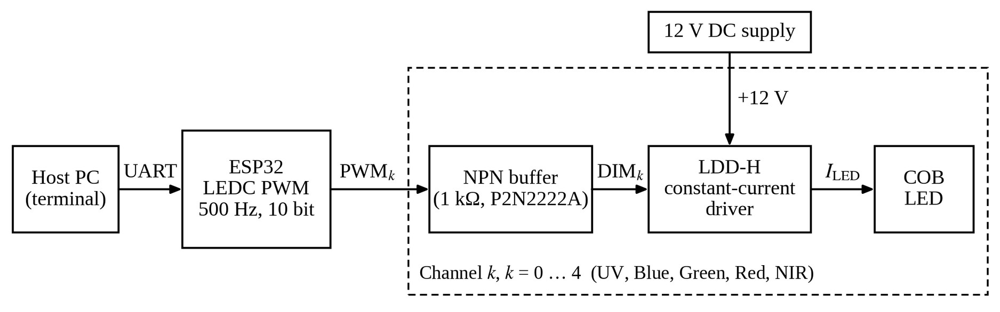
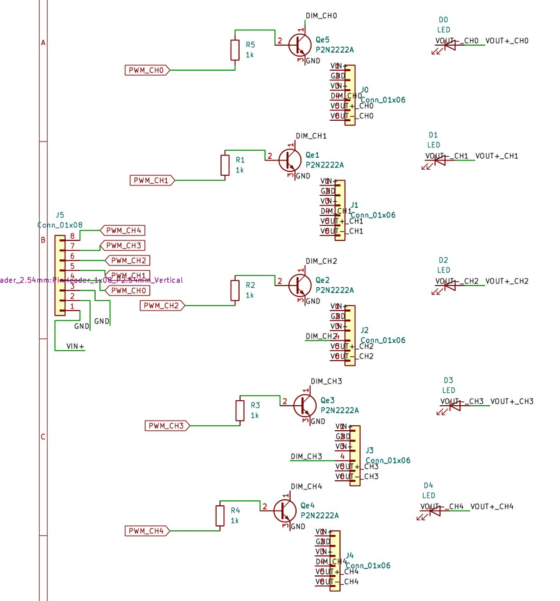
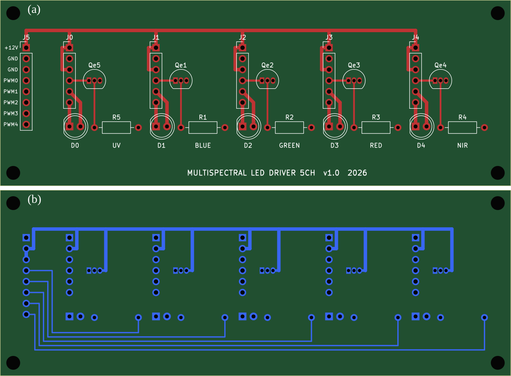
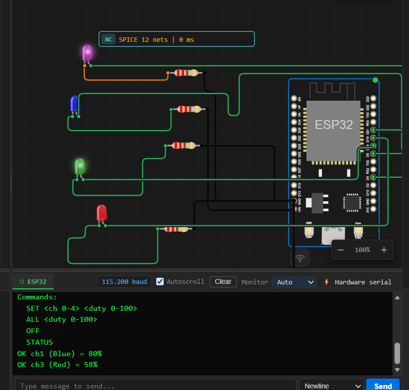
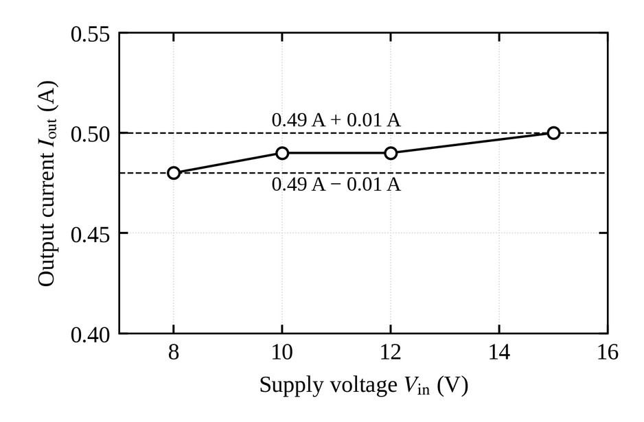
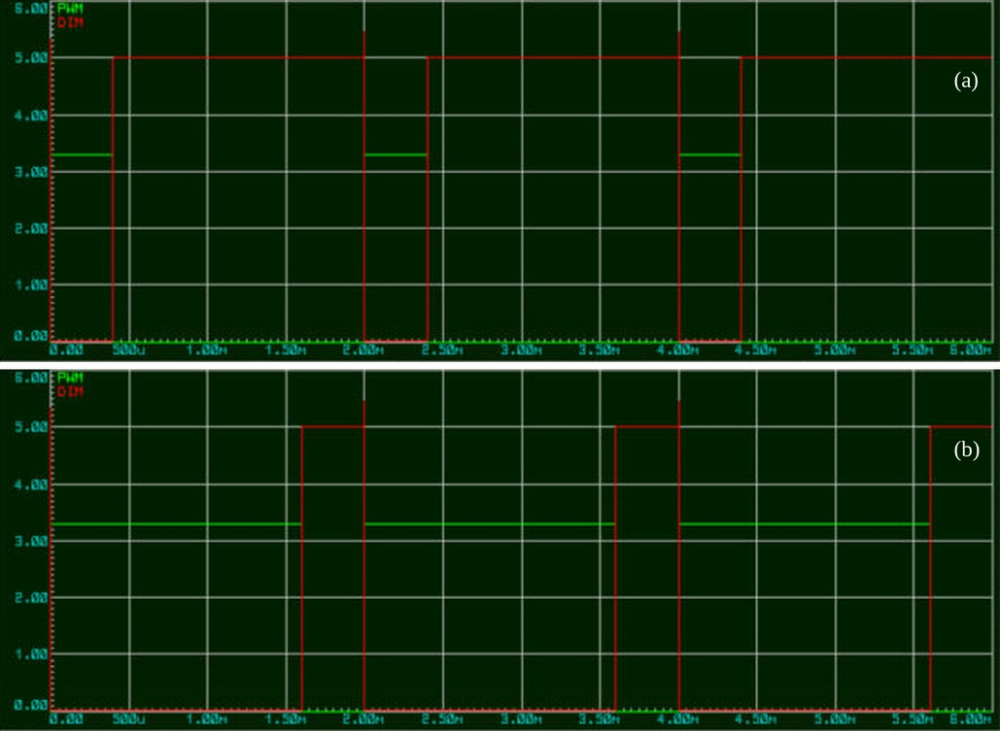
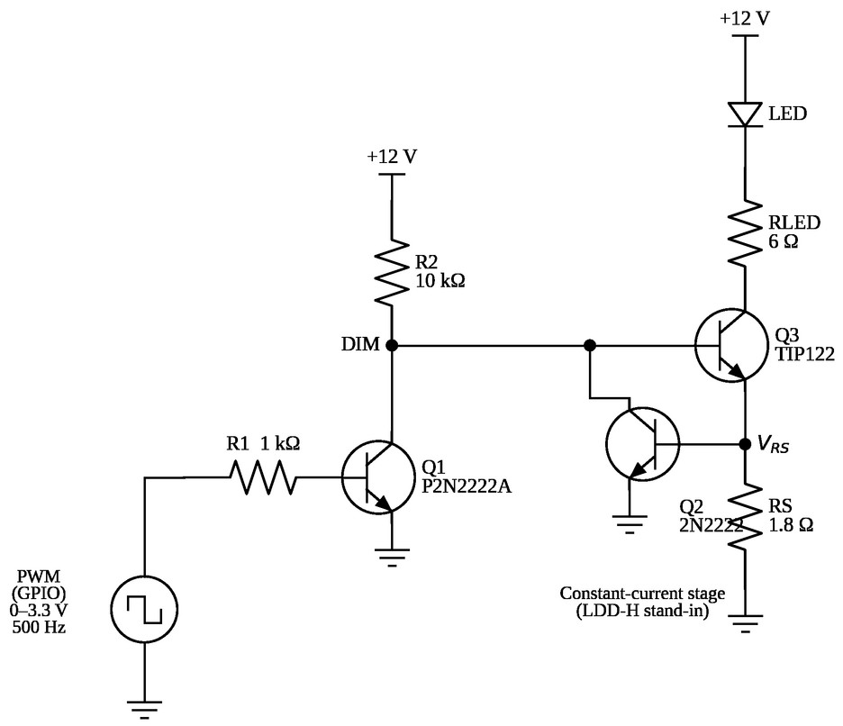
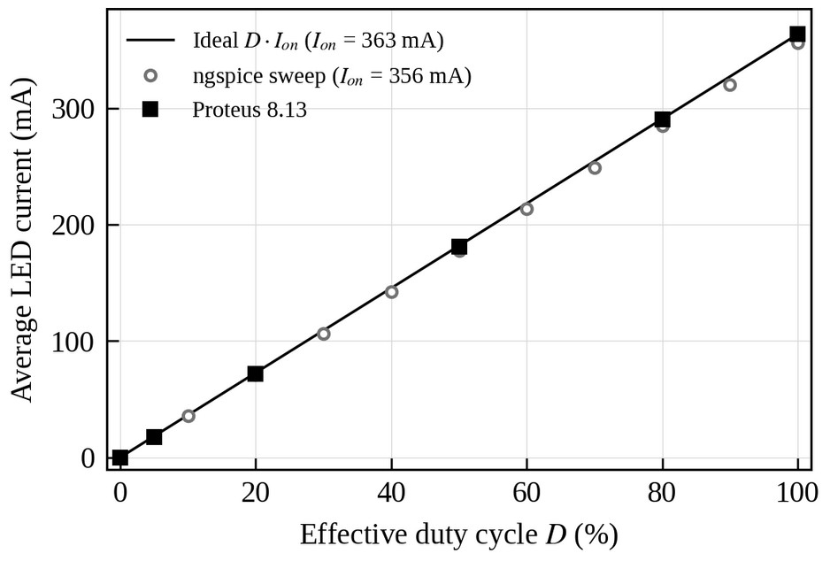

# Phase 1 — Five-Channel Multispectral LED Driver

**ESP32 PWM control · MEAN WELL LDD-H constant-current modules · KiCad 10 · Proteus / ngspice**

Phase 1 of the internship: a driver that powers five high-power COB LEDs (UV, Blue, Green, Red and NIR) for multispectral microscopy. Each color can be dimmed independently from a PC. The design was taken from requirements to a fabrication-ready PCB and verified in simulation. No hardware was built.

Full report (IEEE format): [`report/Multispectral_LED_Driver_Phase1_Report_IEEE.pdf`](report/Multispectral_LED_Driver_Phase1_Report_IEEE.pdf)

  
   <em>One channel k: ESP32 PWM → NPN buffer → LDD-H constant-current module → COB LED. There are five of these.</em>

---

## How it works

High-power LEDs have to be driven with **constant current**, not constant voltage. Their forward voltage changes with temperature and from part to part, so a fixed voltage would give each channel a different brightness and could cause thermal runaway.

The design splits the job in two:

- **The LDD-H module regulates the current.** This is a MEAN WELL step-down constant-current driver (350, 500 or 700 mA versions). It holds the LED current steady whatever happens to the supply.
- **The ESP32 decides how long the current flows.** Its LEDC hardware peripheral produces a 500 Hz, 10-bit PWM signal on each channel (GPIO 4, 5, 18, 19, 21). The LED is either fully on at its rated current or fully off, so the **average** current is

  **Iavg = D · Ion**, where D is the duty cycle.

A P2N2222A transistor sits between each GPIO and the LDD-H DIM input. It isolates the 3.3 V microcontroller from the module, but it also **inverts** the signal: GPIO high → DIM pulled low → LED off. The firmware compensates by writing `1023 − duty`.

A nice side effect of PWM dimming is that the LED always runs at its full rated current while it is on, so its emission spectrum does not shift as the brightness changes. That matters for multispectral imaging.

---

## Step by step: what was done

### Step 1 — Requirements and architecture

I wrote down eight requirements (R1–R8) and linked each one to a test case: five independent channels, 0–100 % intensity, constant current (350–700 mA), a single 12 V supply with a 3.3 V logic interface, a serial command interface, hardware PWM with less than 1 LSB of timing error, a clean two-layer PCB, and thermal margin for every part.

### Step 2 — Schematic and design review

The schematic repeats the same block five times: a 1 kΩ base resistor, a P2N2222A transistor, a 6-pin header for the LDD-H module (J0–J4), and the LED output pads (D0–D4). An 8-pin header (J5) brings in +12 V, GND and the five PWM signals.

Before drawing the PCB I reviewed every connection against the datasheets. **This review found four groups of defects**, two of which would have made the board useless:

| Problem found | Fix |
|---|---|
| The PCB file I inherited contained only graphics (0 pads, 0 nets) | Regenerated the board from the schematic and routed it from scratch |
| The generic NPN symbol used B-C-E pin order, but the P2N2222A TO-92 package is **C-B-E** | Changed to the correct symbol, so base and collector are no longer swapped |
| LEDs D0–D4 were wired with **reversed polarity** | Swapped the VOUT+/VOUT− labels |
| Net-label errors (global vs. local, an undefined net, duplicate connectors) | Unified the labels and aligned references with the PCB |

Result: **KiCad ERC, 0 errors.**

### Step 3 — PCB layout

- Two layers, FR-4, 1.6 mm, 1 oz copper, **118 × 43 mm**, through-hole parts only for easy hand assembly
- Each channel sits in an identical 20 mm cell: header, transistor, resistor, LED
- +12 V bus on top and ground bus on the bottom, both 0.8 mm wide
- No vias needed: 77 pads, 91 track segments, 27 nets
- Silkscreen labels for every J5 pin and every channel color

Result: **KiCad DRC, 0 violations, 0 unconnected items, 0 schematic-parity differences.**

### Step 4 — Firmware

[`firmware/firmware_intern/firmware_intern.ino`](firmware/firmware_intern/firmware_intern.ino) is an Arduino sketch for the ESP32 (Arduino core 3.x; the code has a note on the 2.x API). It accepts text commands at 115200 baud:

| Command | Effect |
|---|---|
| `SET <ch 0–4> <duty 0–100>` | Set one channel's brightness |
| `ALL <duty 0–100>` | Set every channel |
| `OFF` | Turn every channel off |
| `STATUS` | Show name, GPIO and duty of each channel |
| `HELP` | List the commands |

All channels start at `MAX_DUTY`, so the LEDs turn off as soon as the firmware runs. The sketch was run in the **Velxio ESP32 simulator** and passed every command test.

### Step 5 — Circuit simulation

The LDD-H is a sealed module with no public SPICE model, so I simulated each half of the channel with an equivalent circuit, then both halves together:

**a) Constant-current regulation.** A classic two-transistor current limiter was simulated in Proteus while the supply was swept from 8 V to 15 V. The current stayed at **0.48–0.50 A** (within ±0.01 A, which is the resolution of the simulated ammeter).

**b) PWM buffer switching.** The transistor stage turns the 0–3.3 V PWM into a clean 0–5 V inverted DIM signal. The worst edge delay is about **0.17 µs**, under 0.1 LSB of the 10-bit PWM period (1 LSB = 1.96 µs), so it does not affect brightness resolution.

**c) Duty cycle → LED current.** Both halves were joined in one test bench and run at D = 0, 5, 20, 50, 80 and 100 %. The on-current is always 363 mA. Only the fraction of time it flows changes, and the average follows **Iavg = D · Ion** with a constant offset of only −0.7 mA (about 2 LSB). An ngspice sweep from 0 to 100 % confirms the same straight line.

  
  

### Step 6 — Thermal check and test report

Every part on the board runs far below its rating: the transistors dissipate less than 2 mW each, and the 0.8 mm power traces heat up about 4 °C at full load. The real heat sources are the COB LEDs (about 3 W each), which have to be mounted off-board on a heatsink.

The test report has **15 test cases; 14 pass**. The one "fail" (TC-14) is intentional. It shows that the discrete limiter used for simulation would overheat as real hardware (5.5 W in a TO-92 package), which is exactly why the real design uses the LDD-H module.

### Step 7 — Fabrication package

Everything needed to order the board is in [`fabrication/`](fabrication/). For one-click ordering, the ready-made package is [`LED_Driver_5ch_Fabrication_Package_v1.0.zip`](fabrication/LED_Driver_5ch_Fabrication_Package_v1.0.zip).

| Folder | Content |
|---|---|
| `gerbers/` | Gerber X2 (copper, mask, paste, silkscreen, outline), job file, Excellon PTH + NPTH |
| `assembly/` | BOM (5× P2N2222A, 5× 1 kΩ, 5× 1×6 header, 1× 1×8 header, LED positions) and placement file |
| `docs/` | Schematic PDF, Gerber preview, DRC screenshot |
| `README_fabrication.txt` | Board specs and **assembly warnings**: use the P2N2222A (not PN2222A), the square pad is the LED cathode, and don't fit 5 mm LEDs while an LDD-H is installed |

---

## Future objectives for Phase 1

- [ ] **Board v1.1:** add a pull-up (for example 10 kΩ to 3.3 V) on each PWM input. Because the buffer inverts the signal, the LEDs currently run at full current while the ESP32 is booting or being flashed, and this matters most for the UV channel.
- [ ] **Board v1.1:** replace the 5 mm LED footprints (D0–D4) with 2-pin terminal blocks for the COB LED leads.
- [ ] Measure the LDD-H DIM pull-up current and check the 500 Hz dimming linearity on real hardware.
- [ ] Fabricate and assemble the board, and repeat the PWM edge measurements with an oscilloscope.
- [ ] Characterize the LED current of each channel with the real LDD-H modules, and compensate the −0.7 mA offset in firmware if needed.
- [ ] Design the LED heatsink and the optical coupling to the microscope.
- [ ] Sync camera exposures to an integer number of 2 ms PWM periods to avoid frame-to-frame flicker.

---

## Folder contents

| Path | What is inside |
|---|---|
| `report/` | Phase 1 report, IEEE format (PDF, 9 pages) |
| `kicad/` | `led_driver_intern_me.kicad_pro / .kicad_sch / .kicad_pcb`. Open with **KiCad 10**. |
| `fabrication/` | Gerbers, drill, BOM, positions, docs, and the full package as a ZIP |
| `firmware/firmware_intern/` | ESP32 Arduino sketch |
| `simulation/` | Proteus project for the PWM/DIM transient (`.pdsprj`), screenshots `sim_00`–`sim_05`, firmware simulator logs `fw_01`–`fw_03`, and `PWM_LED_Current_Control/` (Proteus project, ngspice netlist, CSV data, plots and its own README) |
