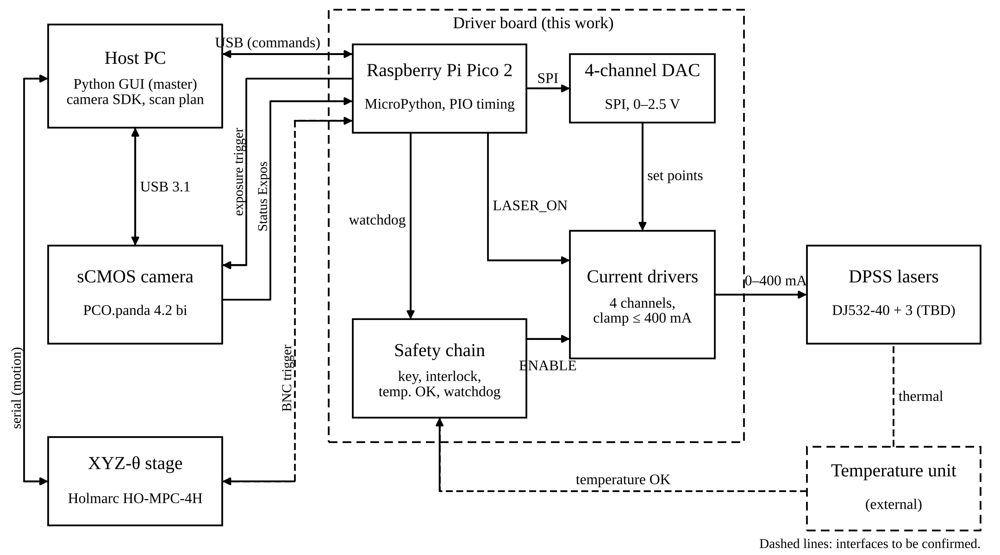
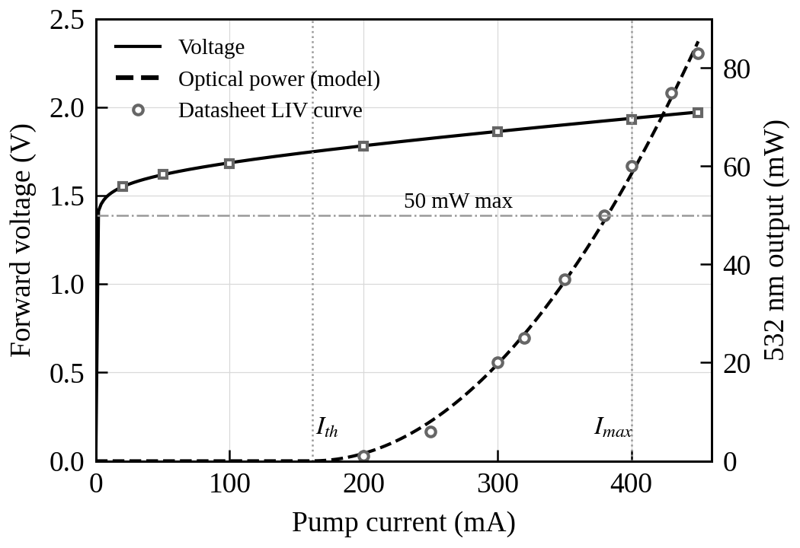
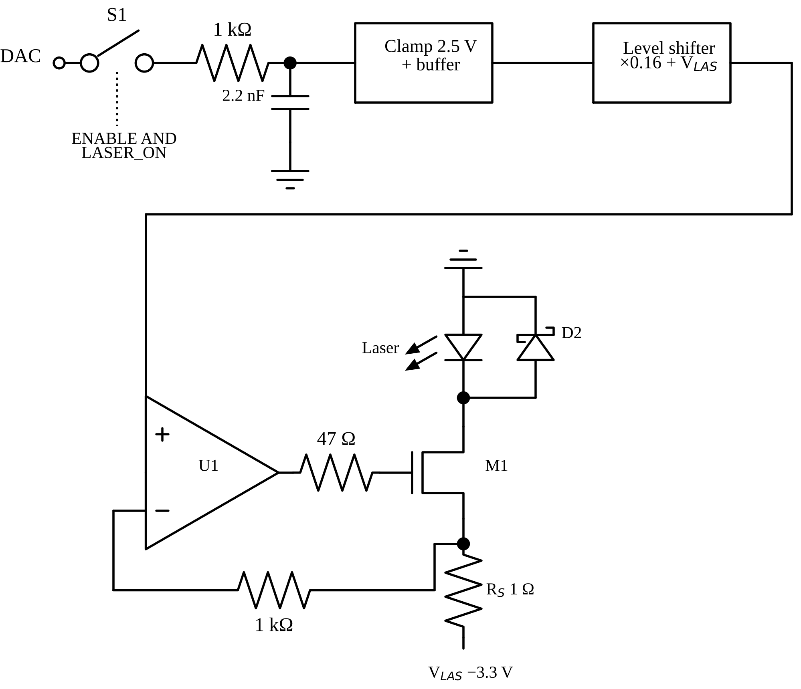
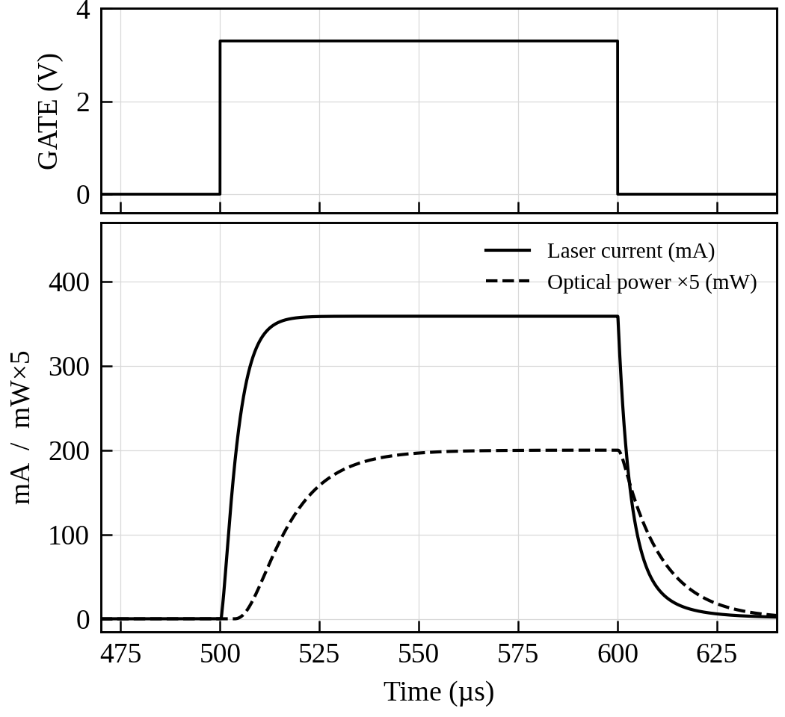
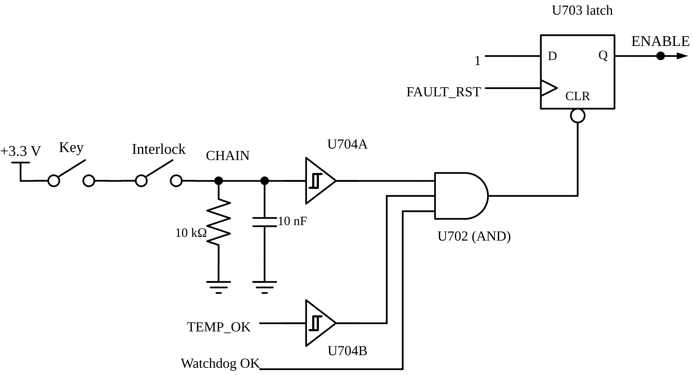
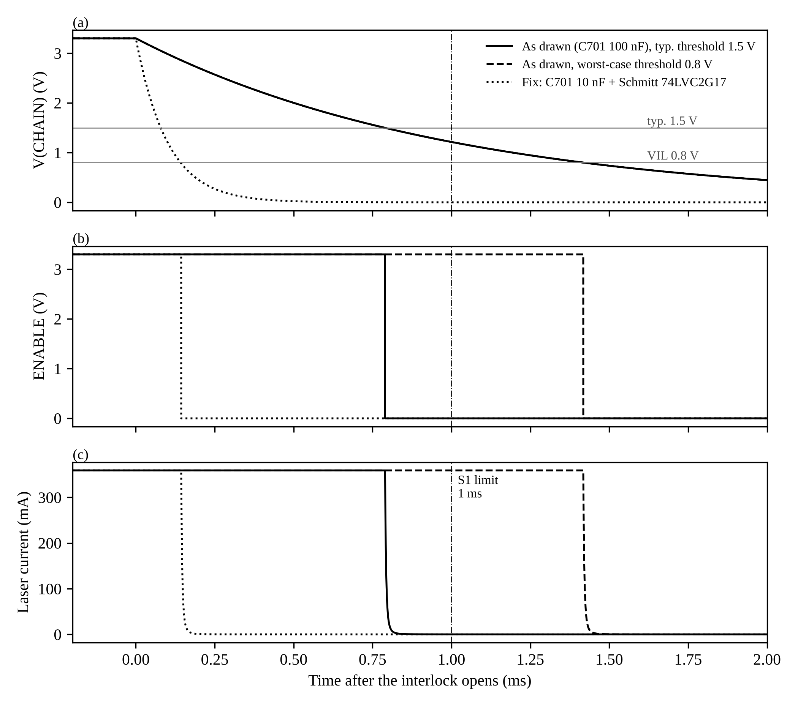
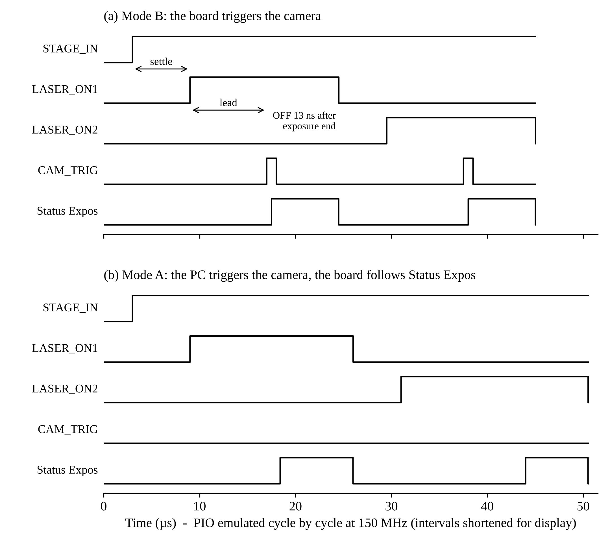
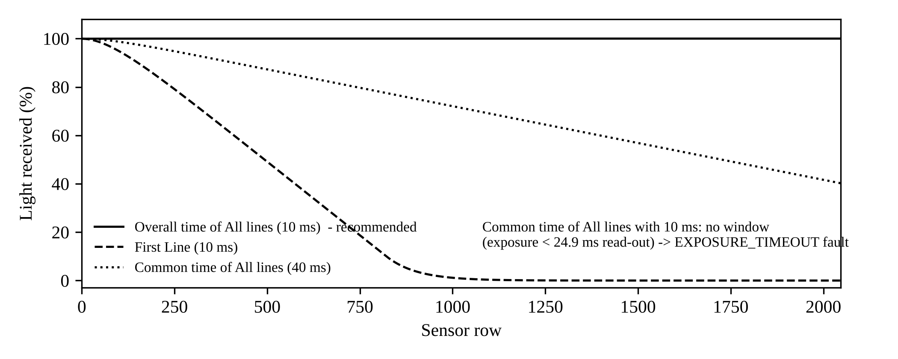
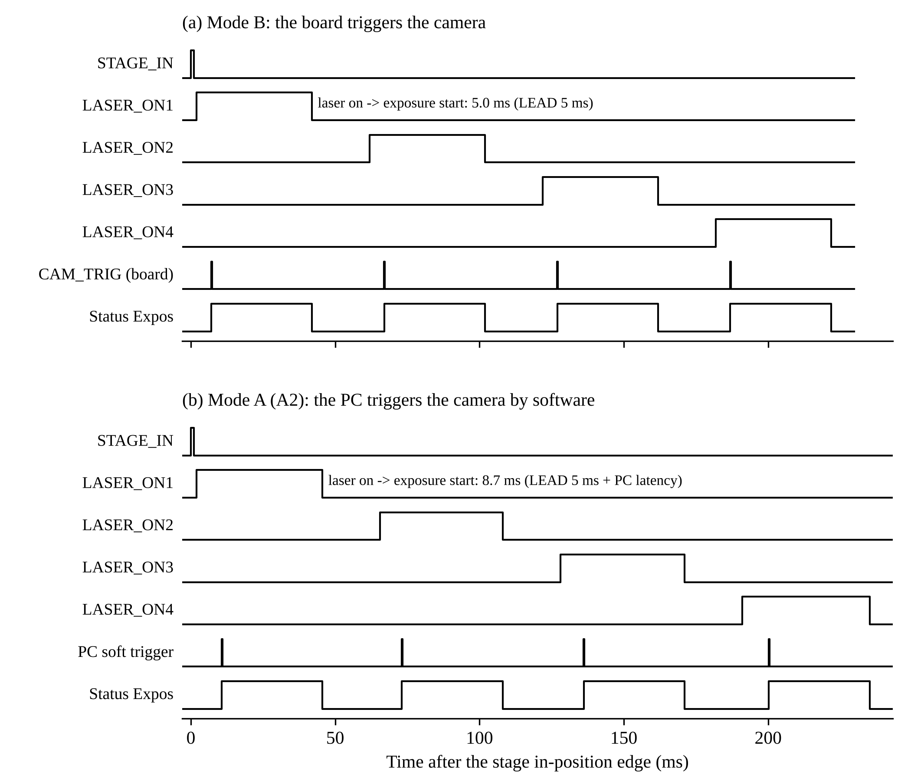
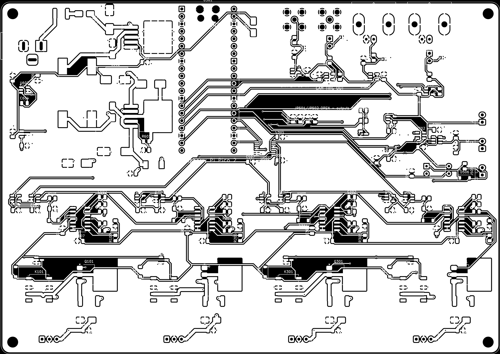

# Phase 2 — Four-Channel DPSS Laser Driver with Camera and Stage Synchronization

**Raspberry Pi Pico 2 (MicroPython + PIO) · DAC8565 · OPA4197 / NDT3055L current sinks · hardware safety chain · KiCad 10 · ngspice / Python**

Phase 2 replaces the LEDs of Phase 1 with **DPSS lasers** (diode-pumped solid-state), starting with the **Thorlabs DJ532-40** (532 nm, 40 mW), and adds what a scanning microscope needs: every image must be taken **with exactly one laser on, at a known time, after the stage has stopped moving**.

The system has three players:

- **Host PC (the master):** holds the scan plan, moves the Holmarc XYZ-θ stage, controls the PCO.panda 4.2 bi camera and stores the images.
- **Driver board (this project):** a Pico 2 that sets the four laser currents and switches each laser on and off in sync with the stage and camera signals.
- **Hardware safety chain:** key switch, interlock, temperature-OK and a watchdog that cut the laser current **without depending on the firmware**.

As in Phase 1, everything was verified in simulation; no hardware was built.

Report (IEEE format): [`docs/DPSS_Laser_Driver_Phase2_Report_IEEE.pdf`](docs/DPSS_Laser_Driver_Phase2_Report_IEEE.pdf)
Requirements and architecture, Rev 3: [`docs/DPSS_Laser_Driver_Phase2_Requirements_Architecture_Rev3.pdf`](docs/DPSS_Laser_Driver_Phase2_Requirements_Architecture_Rev3.pdf)

<p align="center">
  
</p>

---

## How one stage position works

For every position of the snake-by-row scan, the board runs this sequence once per laser. The Pico's PIO state machines execute it in hardware, so the CPU doesn't have to:

```
stage "in position" edge → wait SETTLE → laser k ON → wait LEAD (laser output stabilizes)
→ camera exposure → camera's Status Expos falls → laser k OFF (13 ns later) → wait GAP → next laser
```

Each image therefore gets light from only one laser. Two more state machines time-stamp every stage and camera edge with nanosecond resolution and send the time stamps to the PC.

---

## Step by step: what was done

### Step 0 — Requirements and architecture (3 revisions)

The supervisor set the main decisions: four lasers switched only through their drive current, the PC as master, Python as the language, microsecond-level trigger timing, and the camera treated as something that must never be put at risk. From these I wrote 23 requirements, grouped as functional (F), electrical (E), safety (S), interface (I) and thermal (T), each with a test. The document went through **three revisions**. Revision 3 corrected a camera setting that the simulation in Step 6 showed was wrong.

### Step 1 — A model of the laser

The DJ532-40 was modeled in **ngspice**: a pump diode fitted to the datasheet's voltage curve, plus a green output that grows with the square of the current above threshold (the laser uses frequency doubling), P = K(I − I<sub>th</sub>)², with K = 1.027 W/A² and I<sub>th</sub> = 162 mA.

The datasheet does not give the optical response time τ, so I swept it from 10 µs to 1 ms. With a **5 ms lead time** before each exposure, the light deficit is below 0.07 % even in the worst case.

<p align="center"></p>

### Step 2 — One current channel

Each channel is a **linear current sink**: no switching ripple and a predictable step response. That matters because the DJ532-40 has only 70 mA between its typical (330 mA) and maximum (400 mA) current. The laser's case is its anode, so the anode stays at ground and the current is pulled from the cathode into a −3.3 V rail.

<p align="center"></p>

The DAC voltage passes an analog switch only when ENABLE **and** LASER_ON are high. It is then clamped to 2.5 V, level-shifted and fed to the control amplifier, which drives an NDT3055L MOSFET over a 1 Ω sense resistor. The result is **I = 160 mA/V × V<sub>DAC</sub>**, with a hardware ceiling of **400 mA** at the 2.5 V clamp.

| Test | Result |
|---|---|
| DC transfer | 160.00 mA/V, offset 0.08 mA |
| Hardware clamp (DAC up to 3.3 V) | 400.1 mA |
| Switching | 10–90 % in 8.3 µs, **0 % overshoot** |
| Power-up with the DAC at 3.3 V | 0.000 mA |
| Reverse voltage kick | 0.47 V (laser limit 2 V) |
| Compliance at −5 % rail | 400 mA with V<sub>DS</sub> = 0.54 V |

<p align="center"></p>

### Step 3 — Full schematic with real parts

A hierarchical KiCad project: a top sheet, power, controller (Pico 2, DAC, camera, stage and temperature interfaces), safety, and one laser-channel sheet used four times. In total **183 parts and 144 nets**.

| Function | Part |
|---|---|
| Controller | Raspberry Pi Pico 2 (RP2350) |
| Set-point DAC | DAC8565, 16 bit, 4 channels, 2.5 V reference |
| Op-amps | OPA4197 (quad) |
| Current sink | NDT3055L (SOT-223) |
| Safety logic | 74LVC2G17 Schmitt buffer, 74LVC1G11 AND, 74LVC2G74 latch, TPS3823 watchdog |
| Laser short when disabled | G6K-2F-Y relay |
| Power | LM2596S-5.0, LM2596S-ADJ (inverting, −3.31 V), TPS60403 (−5 V) |

### Step 4 — Safety chain simulation (and the Rev B fix)

The key switch and interlock close a CHAIN line. CHAIN, TEMP_OK and the watchdog go into an AND gate that clears a latch. The latch output is **ENABLE**, which gates all four channels, releases the shorting relays and lights the emission LED. ENABLE comes back only when everything is OK **and** the firmware sends a reset edge.

<p align="center"></p>

I simulated the whole path, from the interlock contact to the laser light. **This found a real problem.** With the original 10 kΩ/100 nF filter, CHAIN falls slowly into a normal CMOS input. With typical thresholds the laser turned off in 0.82 ms, but with the worst-case input threshold it took **1.45 ms**, which fails the 1 ms requirement.

**Rev B** added a Schmitt buffer (74LVC2G17) and reduced the capacitor to 10 nF. Worst case is now **0.18 ms**.

| Case | Current below 1 % | Requirement S1 (≤ 1 ms) |
|---|---|---|
| Interlock, Rev A, typical | 0.82 ms | Pass |
| Interlock, Rev A, worst case | 1.45 ms | **Fail** |
| Interlock or key, Rev B | 0.18 ms | Pass |
| TEMP_OK lost, Rev B | 0.075 ms | Pass |
| Watchdog reset | 0.032 ms | Pass |

<p align="center"></p>

### Step 5 — Firmware (MicroPython + PIO)

The firmware is six MicroPython files, and only one of them (`hw_pico.py`) touches the hardware. That lets the same core run on the Pico and in the PC simulators. Three PIO programs handle the timing: `frame_seq` runs the frames, `edge_ts` time-stamps edges, and `pulse` drives the stage output.

Safety in firmware: at power-up everything is zero and disabled. Set points above the per-laser limit (default 330 mA) are rejected. Any fault switches the lasers off, zeroes the DAC and **stops feeding the watchdog**, so the hardware latch opens too.

With no hardware available, the firmware was validated four ways:

| Check | Result |
|---|---|
| PIO opcodes vs. an independent assembler | 36/36 identical |
| MicroPython syntax (mpy-cross) | 6/6 files compile |
| Unit tests against the requirements | **15/15 pass** |
| Interval error (100 random intervals, cycle-accurate) | ≤ 3.3 ns (requirement 1 µs) |
| Time-stamp error (120 edges) | ≤ 6.7 ns |
| End of exposure → laser off | 13.3 ns |
| Snake scan 4 × 5 positions × 4 lasers | 80/80 images correctly lit |
| Real firmware on a virtual Pico (Wokwi) | Boot, fault, hardware-timed frame: OK |

<p align="center"></p>

Two bugs were found and fixed this way: the stage and camera pins were not configured as inputs, and the main loop did not yield to the USB stack.

See [`firmware/README.md`](firmware/README.md) for the full command set and how to run the verification (`python run_all.py`).

### Step 6 — Camera and stage synchronization

The PC client ran complete snake scans against the simulated board, with a **rolling-shutter camera model** built from the pco.panda manual. The camera's 2048 lines start one after another, 12.17 µs apart, so the last line starts 24.9 ms after the first.

**Finding 1: the camera setting matters.** The board turns the laser off when the camera's Status Expos signal falls, so that signal has to cover the exposure of *every* line. Only the setting **"Status Expos = overall time of All lines"** lights every row. With "First Line", 1555 of the 2048 rows got less than half the light, and that is the kind of mistake no electrical check would ever catch. Revision 2 of the requirements had specified a different setting; Revision 3 fixes it.

<p align="center"></p>

**Finding 2: who triggers the camera.** I compared mode B (the board triggers the camera) with mode A (the PC triggers it by software), using three assumed PC latency profiles. Each case ran 400 images:

| Mode | Exposure start after laser stable | Unused light per image | 4 × 5 scan time |
|---|---|---|---|
| B (board) | 0.031 ms | 5.0 ms | 10.44 s |
| A1 (tuned PC loop) | 1.5 ms | 6.5 ms | 10.57 s |
| A2 (typical Python) | 3.4 ms | 8.4 ms | 10.71 s |
| A3 (15.6 ms Windows timer) | 9.9 ms | 14.9 ms | 11.23 s |

Every image came out correct in every mode: a late trigger costs time, not images. **Mode A is recommended** because it needs no electrical connection to the camera input, and it only costs 1–8 % of scan time. Mode B is still on the board for when repeatable microsecond timing is needed.

<p align="center"></p>

### Step 7 — PCB and fabrication package (Rev B)

- **Four layers, 170 × 120 mm.** Power at the top left, Pico 2 in the center, camera, stage and safety at the top right, and the four channels along the bottom, each next to its laser connector.
- **Layer stack:** In1 is a solid ground plane. In2 carries the −3.3 V laser rail under the channels and ground elsewhere. Each MOSFET drain has its own copper area for heat.
- **Routing:** done with Freerouting using net classes (1 mm for laser currents, 0.3 mm for power, 0.25 mm for signals).
- **Checks:** KiCad 10 **ERC 0 errors**; **DRC 0 errors, 0 unconnected, 0 parity differences**. The checks were repeated after Rev B.

<p align="center"></p>

### Thermal check and test report

The laser channels are well within margin (the MOSFET runs at 35 % of its rating). **The weak point is the −3.3 V inverting converter.** With all four lasers at 400 mA its switch reaches 2.3 A peak, which is 77 % of its 3 A rating. That's above the 50 % target, although at the default 330 mA limit it drops to 65 %.

The test report has 19 test cases: **17 pass**. TC-07 is the failure that led to Rev B (fixed and re-tested as TC-08), and TC-19 (thermal and stress margin) passes only partly because of the converter.

---

## Future objectives for Phase 2

**Waiting on the supervisor**
- [ ] Confirm the stage's BNC signal: voltage level, direction and real step time (300 ms was assumed)
- [ ] Confirm the electrical form of the temperature-OK signal
- [ ] Confirm the camera settings: Status Expos = "overall time of All lines", and trigger mode A
- [ ] Get the specifications of the other three DPSS lasers

**Design improvements**
- [ ] Upsize the −3.3 V converter to a 5 A part (for example LM2678-ADJ with a 5 A Schottky), or use one converter per two channels
- [ ] Repeat the Step 2 simulation with the vendor SPICE models of the OPA4197 and NDT3055L
- [ ] Relax the firmware GAP rule (GAP + LEAD ≥ 25 ms is conservative), saving about 57 ms per stage position
- [ ] Before every scan, have the PC compare the measured Status Expos width with the expected value (exposure + 24.9 ms) to catch a wrong camera setting

**Hardware**
- [ ] Fabricate and assemble the board
- [ ] Measure the real DPSS response time τ (a short τ allows a shorter LEAD), the safety-chain timing, and the PC trigger latency using the board's own time stamps
- [ ] Calibrate the current limit of each laser module

---

## Folder contents

| Path | What is inside |
|---|---|
| `docs/` | Phase 2 report (IEEE, 8 pages) and Requirements & Architecture Rev 3 (7 pages) |
| `kicad/` | KiCad 10 hierarchical project: `DPSS_Driver_4ch.kicad_sch` (top), `power`, `controller`, `safety`, `laser_channel` sheets, `.kicad_pcb`, `.kicad_pro` |
| `fabrication/gerbers/` | 4 copper, 2 mask, 2 paste, 2 silkscreen, outline, job file, PTH/NPTH drill + drill maps |
| `fabrication/assembly/` | Grouped BOM and pick-and-place file |
| `fabrication/docs/` | Schematic PDF, top/bottom PCB images, Gerber preview |
| `fabrication/DPSS_Driver_4ch_Fabrication_Package_RevB.zip` | Everything above in one file, ready to send to a PCB maker |
| `firmware/firmware/` | The six MicroPython files that go on the Pico 2 |
| `firmware/pc/` | PC client (pyserial) and a snake-scan example |
| `firmware/sim/` | PIO assembler check, PIO emulator runs, board model, unit tests, Step 6 camera models; results in `sim/results/` |
| `firmware/wokwi/` | Files to run the firmware on a virtual Pico in Wokwi |
| `simulation/Step1_DPSS_model/` | ngspice laser model and fit |
| `simulation/Step2_Current_channel/` | ngspice channel tests (DC, gate, power-up, reverse, compliance) |
| `simulation/Step4_Safety_chain/` | ngspice/XSPICE safety-chain cases A–E, results CSV |
| `simulation/Step6_Camera_modes/` | Rolling-shutter results, mode A vs B, Status Expos settings |

Each simulation folder has its own `README.txt` with the exact commands to re-run it.
